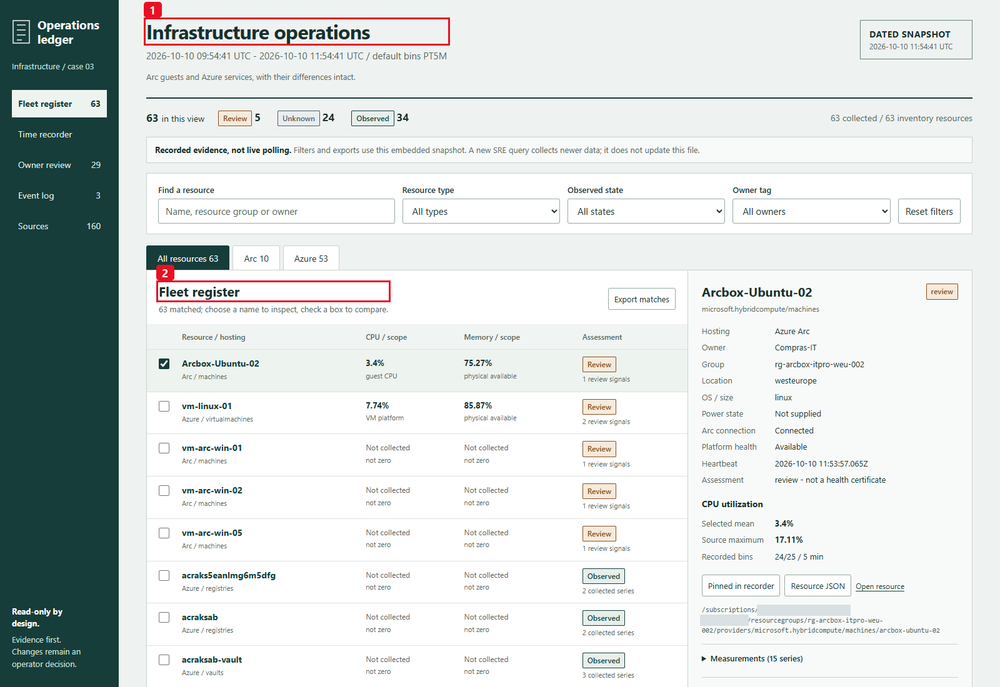
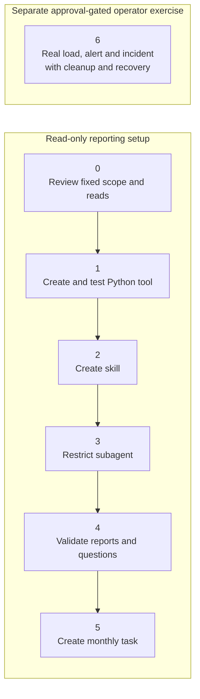
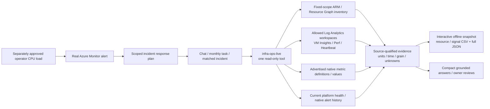
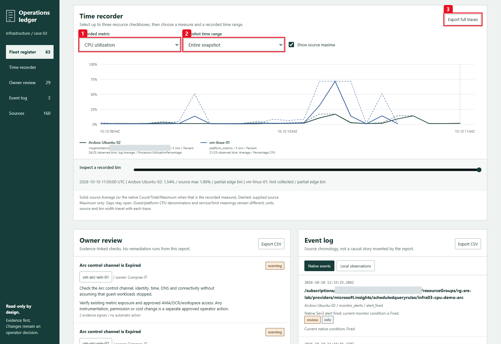
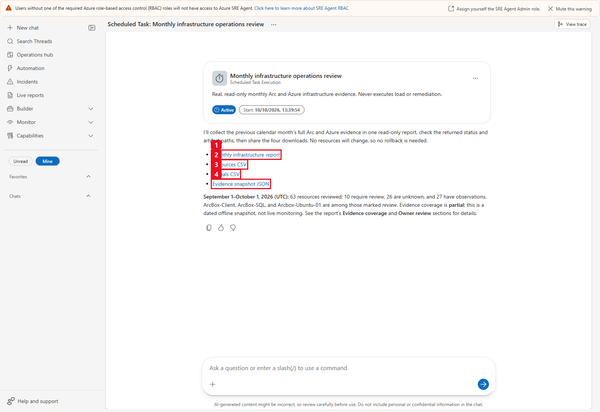

# Use case 03 - Infrastructure operations with Azure SRE Agent

> Read-only real evidence | Azure Arc + Azure-native | Restricted subagent |
> Interactive monthly snapshot | Separately approved CPU demonstration

Turn CPU, memory, capacity, utilization, health and anomalous observations into
an explainable operational review. A single restricted subagent answers fresh,
scoped questions and produces a self-contained HTML report with complete
machine-readable evidence. **Arc guest telemetry and Azure-native metrics share
one workflow, not one invented meaning.**

This case is infrastructure operations, not another security-posture audit.
There is no customer dataset, PDF input, branded simulation, fabricated uptime,
composite health score or automatic remediation.

This public repository contains **case03 infrastructure code and its complete
original illustrated guide only**: two inline setup/runtime diagrams and nine
owner-reviewed original lab screenshots. It contains no customer data, private
deployment configuration, raw lab datasets, cloud credentials or imported
private repository history. Generic lab names are historical examples, not
approved deployment targets. This is a personal, reusable example, not an
official Microsoft product or support commitment. See [sources and attribution](SOURCES.md)
and the existing [MIT license](LICENSE).

**Historical evidence, not a live deployment:** the screenshots and observations
below are from **October 10, 2026**. They are not current availability claims,
guaranteed performance or a production benchmark. Existing companion media
remain available in the [English LinkedIn/video release (v2)](https://github.com/marioaguileraaa/azure-sre-agent-infrastructure-review/releases/tag/case03-linkedin-v2),
including the [70-second video](https://github.com/marioaguileraaa/azure-sre-agent-infrastructure-review/releases/download/case03-linkedin-v2/case03-linkedin-final.mp4),
and the [original release (v1)](https://github.com/marioaguileraaa/azure-sre-agent-infrastructure-review/releases/tag/case03-linkedin-v1).
These links do not imply that anything has been posted to LinkedIn.

## Start here

Follow the complete walkthrough below. [SETUP.md](SETUP.md) is its concise
configuration checklist, not an alternative tutorial. Run offline tests first:

```text
python -m unittest discover -s tests -p "test_*.py"
```

Tests use explicitly synthetic fixtures and make no cloud calls. Optional
private-source replay tests skip when the deliberately excluded
`handoff-inputs` directory is absent. Linux-only stop-channel tests skip on
Windows; neither those tests nor the report should be mistaken for permission
to apply load to a machine.

Install runtime dependencies in your own environment when configuring the SRE
tool:

```text
python -m pip install -r requirements.txt
```

The unconfigured tool fails explicitly with `configuration_required`.
Authentication uses the specifically configured managed identity, not a cached
CLI account or a token supplied in chat. The two canonical Python utilities
retain their original bytes through `.gitattributes`; do not normalize their
line endings when verifying source hashes.

Public reuse requires your own approved scope and read access. Configuring
roles, monitoring, schedules, alert rules, incident routing or an operator
exercise is a separate action, not something this repository performs on import.

## Contents

- [Business value](#business-value)
- [Demo quick start](#demo-quick-start)
- [Verified lab outcomes](#verified-lab-outcomes)
- [Setup steps (guide order)](#setup-steps-guide-order)
- [Sources and metric meaning](#sources-and-metric-meaning)
- [Package contents](#package-contents)
- [Step 0 - Fixed scope and read access](#step-0---fixed-scope-and-read-access)
- [Step 1 - Create and test the Python tool](#step-1---create-and-test-the-python-tool)
- [Optional company logo](#optional-company-logo)
- [Step 2 - Create the skill](#step-2---create-the-skill)
- [Step 3 - Restrict the subagent](#step-3---restrict-the-subagent)
- [Step 4 - Reports and fresh questions](#step-4---reports-and-fresh-questions)
- [Step 5 - Monthly task and run now](#step-5---monthly-task-and-run-now)
- [Step 6 - Real alert to subagent demonstration](#step-6---real-alert-to-subagent-demonstration)
- [Evidence and algorithm rules](#evidence-and-algorithm-rules)
- [Exports and transport limits](#exports-and-transport-limits)
- [Verification and troubleshooting](#verification-and-troubleshooting)
- [References](#references)

## Business value

### The operational problem

An Arc machine can be connected while guest monitoring is absent. A VM can expose
memory metric definitions yet return no measurements. A container's memory limit,
an App Service plan's utilization and Storage service availability cannot be
combined into a fictional host-health percentage. A monthly graph without its
source, units, sample counts and missing periods can conceal these differences.

| Customer need | What this case provides |
|---|---|
| Find pressure before blindly changing capacity | Source-qualified CPU mean/maxima, physical memory, logical-volume free space, provisioned disk utilization and applicable managed-service signals. |
| Demonstrate Arc's operational value | Real VM Insights/Heartbeat observations for Linux and Windows guests, including physical memory and per-volume capacity that control-plane connection cannot establish. |
| Demonstrate Azure-native value | VM/VMSS platform metrics; AKS node aggregates; ACA configured-limit percentages; App Service plan utilization; managed-service availability, latency and capacity. |
| Know what is not monitored | Visible Unknown / Not collected / Unsupported / Error states, exact-ID associations, missing bins and partial historical coverage. |
| Make an owner decision | Evidence-linked review queue using actual owner tags, with unassigned ownership explicit. No automatic restart, resize or instrumentation. |
| Explain an incident | Real native alert conditions and observed chronological annotations, separate from local statistical flags and separate from proof that SRE Agent ran. |
| Review capacity responsibly | Qualified low-demand review candidates that retain peaks, physical-memory evidence and coverage constraints; no invented savings or resizing recommendation. |
| Repeat the review | Monthly UTC calendar report, immediate run-now verification, reusable English questions and complete offline exports. |

Measure owner-reviewed findings, monitoring gaps closed, investigation handoffs,
source completeness and review effort with actual records. This example does
not promise financial ROI, avoided outages, SLA compliance or a certified
healthy estate.

## Demo quick start

1. In a fresh chat, invoke **`@infra-ops-live`** and request the real report for
   `period=last_24h`, both hosting types. Open the actual HTML download.
2. Show Arc CPU, physical available memory and volume capacity. Explain why
   **Connected** is not guest health, and why empty Perf does not invalidate
   successful VM Insights.
3. Switch to Azure resources. Distinguish VM measurements from stopped/no-data
   VMs, ACA limits, plan/node aggregates and managed-service signals.
4. Ask one scoped source-grounded question, then inspect the owner review and
   coverage evidence. The downloaded report does not poll for newer data.
5. Run the monthly task once from **Automation -> checkbox -> Run now** and
   verify the real thread and all four files.
6. Only after the user approves the **exact dedicated Arc host and Azure VM**
   and any required start/restore operation, use the separate operator CPU
   exercise. Prove native alert -> incident -> `infra-ops-live` -> recovery.
   A manual chat is not automatic-trigger proof.

The copy-ready questions and focused parameter examples are in
[`subagent-instructions-and-prompts.md`](subagent-instructions-and-prompts.md);
[`chatprompt.txt`](chatprompt.txt) contains the English read-only demo prompt.



This is the actual final two-hour snapshot, collected at **11:54:41 UTC**.
Use the heading's measurement window (1), then the fleet register (2) to select
a resource and inspect its own source/units. The subscription identifier is
masked; the displayed observations are real historical lab evidence, not a fresh
collection for this public guide.

<a name="what-was-actually-observed"></a>

## Verified lab outcomes

The final deployed implementation was exercised against **real lab sources on
October 10, 2026**. The scope contained 63 resources: **10 Arc resources**
(including eight machines and two connected clusters, not ten guest servers) and
**53 Azure-native resources**. No customer PDF, synthetic dataset or simulated
alert was deployed.

| Acceptance check | Observed result |
|---|---|
| Restricted deployment | The standalone tool, `infra-ops-live` skill and subagent were created and read back with one selected tool and one skill; execution tools were not inherited. |
| Current evidence | The final two-hour snapshot covered 09:54:41-11:54:41 UTC, all 63 resources, 253 series and 6,023 points. Missing/currently stopped sources remained qualified. |
| Monthly automation | The same monthly task, cron `0 9 1 * *`, was manually run at 11:54:38 UTC and finished at 11:55:29 UTC. It used one complete previous-month report call and displayed all four normal native downloads. |
| Complete month | September 1 through October 1 UTC; 269 series and **171,059 points** retained. `partial` describes evidence coverage, including limited native alert history, not a failed export. |
| Actual downloads | HTML, resource CSV, signal CSV and JSON all returned HTTP 200 for both final current and monthly runs. None exceeded 4,800,000 bytes. |
| Offline interactions | Actual HTML was checked at desktop 1440 px and mobile 390 px: hosting filters, resource drilldown, multi-resource traces and complete CSV/JSON exports; all decoded snapshot fields/points matched, without external requests, JavaScript errors or page overflow. |
| Linux path guard | The actual SRE Linux runtime rejected a symlink escape with `unsafe_artifact_directory`; no cloud read or report artifact was produced by that negative check. |

The final September downloads were **1,261,116 bytes HTML**, **1,200,185 bytes
JSON**, **61,456 bytes resource CSV** and **60,847 bytes signal CSV**. These
sizes belong to that dated run, not a guaranteed size for every estate/month.
Earlier failed size/sharing attempts remain in execution history; they are not
counted as successful monthly delivery. Codec 2.0 and the one-call/native-alias
contract solved those failures without narrowing the month or dropping sources.

### Automatic incidents, not manual chat invocations

| Flow | Measured operator exercise | Native alert and automatic investigation |
|---|---|---|
| Azure `vm-linux-01` | 11:05:29-11:13:29 UTC; 480 seconds; 479 host-CPU samples, mean **71.95%**, maximum **74.5%**; all created workers stopped. | 65% teaching rule fired at 11:10:30 UTC. The genuine SRE incident matched `infra03-cpu-demo-native-response`, invoked the restricted read-only investigation and reached **Complete**. |
| Arc `Arcbox-Ubuntu-02` | 11:31:19-11:39:19 UTC; 480 seconds; 479 samples, mean **14.01%**, maximum **25%**; target criterion passed; all created workers stopped. Its unchanged 0.3-core command quota is described below. | 10% teaching rule fired at 11:33:15 UTC. The genuine SRE incident matched `infra03-cpu-demo-arc-response` and reached **Complete**, with source-qualified guest CPU evidence rather than a host-wide saturation claim. |

Operator host-sample averages are **not** the report's five-minute metric-bin
averages. The two teaching thresholds are not production SLOs.

Both investigations explicitly performed **no remediation** and did not claim a
proven CPU root cause. The restricted handler lacks external incident-posting
capability: its completed chat investigation is not proof of a ticket update.
Automatic invocation, source alert resolution, CPU recovery and VM power-state
restoration are separate facts. The native alert's monitor condition resolved at
**11:19:36 UTC**, CPU returned to about 0.9%, and the approved VM was verified
back in its original deallocated state.
Arc CPU returned to approximately its baseline; the stateful log-alert resolution
was separately verified as **Resolved at 11:56:54 UTC**, without manually forcing
the alert state or disabling its rule. `ArcBox-Client` was then verified back in
its original deallocated state at **11:59:42 UTC**. All ten explicitly named Arc
diagnostic Run Command resources were removed and their subsequent GETs
verified HTTP 404. Existing workloads, monitoring permissions, agent quotas and
extension configuration were not changed to force the result. This historical
cleanup is not a statement about the machines' state today.

The Arc alert's user-facing `alertState` can remain **Acknowledged** while
`monitorCondition` is **Resolved**. Those are different source fields; the
report and investigation do not substitute one for the other.

Existing tools, skills and agents were hash-compared unchanged, and the nine
pre-existing tasks retained their stable configured fields. The one existing
incident-plan exception is the narrowly documented title exclusion
below; it must not be presented as an unchanged plan definition.

## Setup steps (guide order)

The numbers match the guide headings, **not runtime execution order**.
Steps 0-5 configure and validate read-only reporting. Step 6 is a **separate,
approval-gated operator demonstration**, not a dependency or operation of the
monthly task; the agent never runs the load script.



| Setup step | Component | Expected result |
|:---:|---|---|
| 0 | [Fixed scope/read access](#step-0---fixed-scope-and-read-access) | Subscription, tenant, UAMI and approved workspaces configured; actual reads verified. |
| 1 | [Python tool](#step-1---create-and-test-the-python-tool) | Complete source, typed parameters and actual report/query results checked. |
| 2 | [Skill](#step-2---create-the-skill) | Only the read-only report/query tool attached. |
| 3 | [Subagent](#step-3---restrict-the-subagent) | One explicit skill/tool; no execution or remediation tools inherited. |
| 4 | [Reports/questions](#step-4---reports-and-fresh-questions) | Actual downloads, source-qualified evidence and fresh scoped answers validated. |
| 5 | [Monthly task](#step-5---monthly-task-and-run-now) | One complete previous-month report call and immediate run-now acceptance. |
| 6 | [Separate operator demonstration](#step-6---real-alert-to-subagent-demonstration) | Exact targets/actions approved; real load, native alert, restricted incident handling, cleanup and recovery independently verified. |

## Sources and metric meaning

### Runtime data flow



| Resource / source | Useful observations | Must not be inferred |
|---|---|---|
| Arc + `InsightsMetrics`, `Origin=vm.azm.ms` | `Processor/UtilizationPercentage`; `Memory/AvailableMB`; `memorySizeMB`-grounded available percentage; `LogicalDisk/FreeSpacePercentage`. | Connection/provisioning as guest health; missing guest RAM as zero. |
| Supported guest `Perf` counters | Total CPU, available/used physical memory, Windows commit and free space on a named volume. | Windows commit as physical RAM, or successful empty Perf as failure of another source. |
| `Heartbeat` | Last agent observation and age at the requested window end. | Application availability or separate VMs from agent/Computer rows sharing one `_ResourceId`. |
| Azure VM / VMSS | Advertised CPU, available memory, disk IOPS/bandwidth and VM availability metrics, when values actually exist. | Memory readiness from a definition alone; timestamp-only points as zero; scale-set aggregates as individual instance health. |
| AKS | Native CPU/RSS/disk percentages, cluster-aggregated unless metadata identifies a narrower scope. | Individual ARM VMs from the node/agent count, or a complete workload health audit. |
| Container Apps | CPU/memory relative to configured limits, nano-core/working-set usage, replicas and requests. | Host physical RAM, a fabricated capacity denominator, or maximum replicas as sample counts. |
| App Service | Per-app CPU time/working set and **serverfarm plan** CPU/memory percentages. | A plan-wide percentage as one app's memory, or CPU time as host CPU utilization. |
| Key Vault / Storage / ACR / supported databases | Only semantically applicable advertised availability, latency, request/capacity or database utilization metrics. | Host CPU/RAM for a managed service; capacity forecast, quota or SLA without evidence. |
| Resource Health | Current platform state, native reason/context and any returned recently-resolved annotation. | Reconstructed monthly guest health; deliberate deallocation as an unplanned outage. |
| Azure Monitor Alerts Management | Returned Fired/Resolved conditions and supplied native timestamps. | Complete lifetime history, a local flag as a native alert, or an alert row as proof that SRE handled it. |

The native adapter respects advertised units, aggregations and safe time grains.
Optional native dimensions remain aggregated by default; returned dimension
metadata is retained, required dimensions are requested explicitly. No
workload topology or dependency edges are invented.

<a name="package"></a>

## Package contents

Open a file link and select **Download raw file** in GitHub's file view to save
a local copy for configuration/pasting. The links below stay within this public,
case03-only package.

| File | Purpose |
|---|---|
| [`generate-infrastructure-operations-report.py`](generate-infrastructure-operations-report.py) | Standalone read-only report/query tool: fixed-scope ARM/ARG inventory, approved-workspace guest telemetry, native metrics, platform health and alert evidence. Writes interactive HTML, resource/signal CSV and complete JSON; scoped queries retain coverage, units, missing data and paging. |
| [`tool-parameters.schema.json`](tool-parameters.schema.json) | Exact typed parameters, enums, defaults and bounds. |
| [`requirements.txt`](requirements.txt) | `requests`, `azure-identity` and Pillow for optional company-logo validation; other imports are standard library. |
| [`skills/infra-ops-live/SKILL.md`](skills/infra-ops-live/SKILL.md) | Source semantics, focused queries, incident procedure and safety. |
| [`subagent-instructions-and-prompts.md`](subagent-instructions-and-prompts.md) | Restricted instructions, English questions and JSON calls. |
| [`chatprompt.txt`](chatprompt.txt) | Copy-ready English read-only demo prompt. |
| [`monthly-task-prompt.md`](monthly-task-prompt.md) | Task name, responder, UTC cron, prompt and immediate acceptance gate. These files do not create or run a schedule. |
| [`controlled-cpu-load.py`](controlled-cpu-load.py) | **Operator-only** Linux host-confirmed CPU exercise: baseline/headroom checks, target <=82%, duty <=85%, sampled 85% stop ceiling, maximum 480 seconds/eight workers; never an agent tool, skill asset or scheduled action. |
| [`tests/`](tests/) | Offline synthetic contract tests and optional ignored real-source shape replays. No private datasets are included. |
| [`PRODUCT.md`](PRODUCT.md) | Scenario-local, confirmed product boundaries. |
| [`DESIGN.md`](DESIGN.md) | Finished operations-ledger visual contract, extracted tokens and responsive behavior. |
| [`images/`](images/) | Nine original owner-reviewed historical captures with preserved red callouts and dated captions. |
| [`SETUP.md`](SETUP.md) | Concise checklist linked to the complete walkthrough below. |
| [`SOURCES.md`](SOURCES.md) | First-party references, illustration attribution and public media links. |
| [`LICENSE`](LICENSE) | Existing MIT license for this code, not for Microsoft services, portal UI or third-party packages. |

Raw API handoffs are ignored, private validation inputs. They are not a
committed dataset, deployed fixture or sample report. Private provenance,
privacy receipts and raw captures are not part of this public package.

## Step 0 - Fixed scope and read access

Configure the constants at the top of
[`generate-infrastructure-operations-report.py`](generate-infrastructure-operations-report.py)
before deployment:

```python
SUBSCRIPTION_ID = "<YOUR_SUBSCRIPTION_ID>"
TENANT_ID = "<YOUR_TENANT_ID>"
MANAGED_IDENTITY_CLIENT_ID = "<YOUR_AGENT_CLIENT_ID>"
LOG_WORKSPACE_IDS = ["<YOUR_APPROVED_ARC_WORKSPACE_GUID>"]
```

Use the identity's **Client ID**, not its Object/Principal ID. The code uses
`ManagedIdentityCredential(client_id=...)` explicitly; it does not fall back to a
cached CLI account or require an injected global credential. Subscription state
must be **Enabled** and its tenant must match. Add only specifically approved
workspace GUIDs; there is no automatic discovery of other subscriptions.

| Access | Required purpose |
|---|---|
| Subscription/resource **Reader**, or narrower approved equivalent | Inventory, metric definitions/values, Resource Health and native alert reads. |
| Approved Log Analytics data-read access | Query the configured workspaces and required tables. Existing Reader can be sufficient under the workspace's access mode; verify it rather than blindly granting another role. |
| User: **SRE Agent Author** on the **SRE Agent resource > Access control (IAM)** | Customize the agent, create custom agents, author response plans and configure incident management. |
| User: **SRE Agent Standard User** on the same agent resource | Chat/run diagnostics, upload knowledge and create/manage scheduled tasks. Combine with Author for the full portal workflow. |

**SRE Agent Administrator** is the full-management alternative to **Author +
Standard User**. **Builder** is a portal navigation label, not a named role.
Author alone cannot chat/create tasks; Standard User alone cannot create custom
agents. Azure Owner/Contributor do not replace SRE Agent data-action roles, and
a visible button can still return 403. See [User roles and permissions](https://learn.microsoft.com/azure/sre-agent/user-roles).
These human roles are separate from the UAMI's read access above; this
infrastructure-only workflow does not require a Microsoft Graph grant.

For branding, use the existing [optional company-logo settings](#optional-company-logo).
Keep `COMPANY_LOGO_DATA_URI` empty for the default placeholder; no new runtime
parameter or alternative upload method is needed.

Probe actual managed-identity reads first. If workspace/table access is denied,
report that blind spot and obtain explicit permission for any change. Do not
enable AMA, a DCR, diagnostic settings, paid monitoring or a broader role from
the tool. Existing monitoring and usage can have costs; read-only is not a
promise that SRE runs or log queries are free.

## Step 1 - Create and test the Python tool

1. Open the agent in [SRE Agent](https://sre.azure.com) and go to its tools page
   (**Build + setup / Tools and skills**, or **Builder** in older layouts).
2. Create a **Python tool** named
   **`generate-infrastructure-operations-report`**. Describe it as read-only
   source-grounded infrastructure evidence, not an execution/remediation tool.
3. Paste the complete configured
   [`generate-infrastructure-operations-report.py`](generate-infrastructure-operations-report.py).
   Use the typed `main()` signature
   and [`tool-parameters.schema.json`](tool-parameters.schema.json); do not add
   arbitrary paths, KQL, URLs, token or subscription parameters.
4. Ensure the dependencies in [`requirements.txt`](requirements.txt) are
   available; Pillow is needed only when a company logo is configured. Set a bounded tool
   timeout appropriate to the estate; the SRE preview maximum is 900 seconds.
   The fixed source/row/bin/page and plain-artifact limits remain enforced.
5. In the playground, test a short, focused `query` first, then a real report.
   Confirm source status, units, missing values, exact counts and complete JSON.
6. Create the tool only after checking the actual result. A syntax check alone
   does not verify access or file publication.

```json
{"operation":"query","view":"metrics","hosting":"arc","resource_name":"<ARC_RESOURCE_NAME>","period":"last_2h"}
```

```json
{"operation":"report","period":"last_24h"}
```

### Optional company logo

The top-right header includes a restrained **`logo company`** placeholder.
The cropped header below is from the actual report generated at
**13:09:51 UTC on October 10, 2026**: the optional logo frame (1) stays separate
from the dated snapshot stamp (2).


Configure these constants near the top of
[`generate-infrastructure-operations-report.py`](generate-infrastructure-operations-report.py)
to replace it without changing the report's colors, evidence or runtime parameters:

```python
COMPANY_LOGO_DATA_URI = ""  # Keep empty to display "logo company".
COMPANY_LOGO_ALT_TEXT = "Company logo"
```

Use an authorized, single-frame **PNG or JPEG** logo, at most **100,000 bytes**
and **2048 by 2048 pixels**. This local command generates the configuration
block for a PNG on Windows, with short quoted chunks that Python joins into
one data URI:

```powershell
python -c "import base64, sys, textwrap; from pathlib import Path; b = Path(r'C:\path\company-logo.png').read_bytes(); 0 < len(b) <= 100000 or sys.exit('Use a logo of 1 to 100000 bytes'); u = 'data:image/png;base64,' + base64.b64encode(b).decode('ascii'); print('COMPANY_LOGO_DATA_URI = (\n' + '\n'.join('    ' + repr(s) for s in textwrap.wrap(u, 88)) + '\n)')"
```

Replace the empty `COMPANY_LOGO_DATA_URI = ""` line in the Python tool editor
with the generated block, and set `COMPANY_LOGO_ALT_TEXT` to a descriptive name such
as `"Your company logo"`. For a JPEG, use `data:image/jpeg;base64,` instead.
There is no runtime filename/upload parameter, remote image fetch or CDN.
The image stays inside the offline HTML; JSON/CSV evidence and chat responses
do not carry logo bytes. The dated snapshot stamp remains visible beside or
below the frame, including on phones.

**Pillow is required only when a logo is configured**, to verify and decode the
bounded raster; it is listed in `requirements.txt`. Invalid nonempty data,
unsupported formats, mismatched MIME types, oversized images or missing
validation dependencies return explicit errors, not a broken image or silent
placeholder fallback. The existing 4,800,000-byte artifact limit includes the
embedded logo. After changing it, update the Python tool and generate a report
to verify the header and actual downloads.

## Step 2 - Create the skill

Create a skill named **`infra-ops-live`** using
[`skills/infra-ops-live/SKILL.md`](skills/infra-ops-live/SKILL.md), and attach only
the report/query tool. The operator load script is not a skill asset or a tool.
Preserve its distinctions between native alerts, local flags, current health,
windowed measurements and incomplete monitoring.

## Step 3 - Restrict the subagent

Create **`infra-ops-live`** in the Agent Canvas/custom-agent page and paste the
instructions from
[`subagent-instructions-and-prompts.md`](subagent-instructions-and-prompts.md).
Attach the one skill and **explicitly select the one Python tool**.

Do not leave **Choose tools** empty: some portal versions then inherit all
global tools. Do not attach a shell, run-command, stress, write-capable connector
or default remediation toolbox. Read-only code and narrow tool selection are
both boundaries; a prompt alone is not a permission control.

## Step 4 - Reports and fresh questions

Copy-ready prompts and scoped JSON examples are in
[`subagent-instructions-and-prompts.md`](subagent-instructions-and-prompts.md).

Reports accept local hosting/resource filters and an explicit measurement
period. `period=auto` selects the **previous UTC calendar month** for reports
and **last 24 hours** for queries. Use `last_2h` or `last_24h` explicitly when
showing today's activity.

| Control / evidence | Demonstration |
|---|---|
| Resource filters and drilldown | Move between Arc and Azure without swapping to a synthetic deployment. |
| Recorded time-series comparisons | Compare the same metric/unit/window and retain the guest/platform denominator distinction. |
| Signal evidence | Open source maxima, threshold/MAD criteria and exact affected resources; separate pressure from a monitoring gap. |
| Chronology | Follow returned native alert/health timestamps; no invented event or root-cause link. |
| Owner review | Show actual owner tags and concrete checks instead of a generic "optimize your infrastructure" paragraph. |
| Exports | Download all filtered matches, not just displayed rows; full normalized data stays in JSON. |

Fresh query calls collect new data. They do not mutate an older HTML file.
Respect the actual paging fields; returned rows and last-two-point samples are
not totals. Unsupported filter combinations fail explicitly.



Pin `Arcbox-Ubuntu-02` and `vm-linux-01` in the register. Select the metric (1)
and recorded time range (2), optionally show source maxima, then inspect a bin
or export the **full** pinned traces (3). This final dated capture preserves
their different achieved CPU levels and missing bins; its Arc event was still
Fired at the 11:54:41 collection. The later resolution is a separate verified
event, not retroactively painted into this snapshot.


Read **Evidence coverage** (1) before deciding what is monitored. Arc platform
host metrics being unsupported is expected: its guest evidence comes from the
configured VM Insights/Heartbeat sources. An empty or unsupported source is
not a measured zero, and a completed source request is not a health certificate.

## Step 5 - Monthly task and run now

Use [`monthly-task-prompt.md`](monthly-task-prompt.md):
**`Monthly infrastructure operations review`**, response subagent
**`infra-ops-live`**, custom cron **`0 9 1 * *`**.
This means day 1 at 09:00 UTC, not a local-time schedule that follows daylight
saving changes.

After creation, select the task's checkbox in **Automation** and the enabled
toolbar **Run now**. Open the real execution thread and verify the Python
result, all four actual downloads, report interactions and one grounded
question. **Success** on the automation row is not proof of completed Python or
published files. A **No thread found** view also needs an explicit thread/file
check. Do not wait a month to discover that sharing failed.

The task makes **one full previous-month report call**, immediately displays its
four provided native links/widgets, and gives a compact summary from the return
envelope. It does not query newer 24-hour data to elaborate a monthly answer.
Any grounded follow-up question belongs in a separate, explicitly requested
chat; the HTML/JSON already contain the detailed measurements and limitations.


The final report was collected on October 10 at **11:54:46 UTC**, but its
measurement window (1) is **September 1-October 1 UTC**. The register (2) keeps
the full 63-resource scope, not just currently running or connected machines.
Current platform state and missing portions of that month remain qualified.


Select only the scenario's checkbox (1), then **Run now** (2). This cropped
actual UI example is from the earlier **11:39 UTC** run and shows three history
entries; unrelated tasks are excluded from the image. The final verified
11:54:38 execution is the **fourth** retained entry, not a replacement of the
earlier failures/retries.



This real native-widget example is from the **11:39:54 UTC** run after the
sharing-contract fix, before the final package-image/mobile corrections.
The final implementation independently delivered the same four formats in
**50.618 seconds** with HTTP 200 downloads; its exact final sizes and
source/coverage facts are recorded in [Verified lab outcomes](#verified-lab-outcomes).
The screenshot is not used as proof of the later source version.

## Step 6 - Real alert to subagent demonstration

### Safety gate

The user must confirm the **exact Arc resource ID/guest hostname and native VM
resource ID/guest hostname** before load. Record their OS, CPU count, current
telemetry, dedicated-lab purpose, original power state, approved duration,
independent stop channel and recovery plan.

If the native VM is deallocated, obtain separate approval for startup and
restoring its original power state. Do not substitute a running AKS/K3s node,
production machine or different cached subscription. The report, skill,
subagent and monthly task never generate load or start/stop a resource.

For this lab acceptance run, a **human explicitly approved** the Development
Arc host `Arcbox-Ubuntu-02` and the Azure Linux VM `vm-linux-01` in
`automatizaciones`, including temporary startup, restoration to the original
deallocated state and its small compute cost. The approved exercise is bounded
to eight minutes, with the script's 85% duty cap and sampled CPU stop ceiling.
This target-specific authorization does not approve other hosts, SQL, ADFS,
Kubernetes nodes, permission changes or instrumentation. Authorization alone is
not proof that load, automatic incident handling or recovery succeeded.

The Arc guests in this lab are nested under `ArcBox-Client`. Its deallocation
stopped guest observations; that temporal gap is expected missing evidence, not
a report defect. A human separately approved temporarily starting this parent
VM and restoring its original deallocated state. Starting the host may start
other nested guests, but the CPU exercise remains restricted to the approved
Ubuntu guest. Never infer permission to stress SQL, ADFS or another guest from
permission to start the hypervisor.

### Prepare two real alert sources

| Arc Linux/Windows guest | Azure-native VM |
|---|---|
| Use the real Arc workspace's VM Insights CPU and the exact `_ResourceId`. | Use the target VM's native `Percentage CPU` metric and its actual values. |
| A scheduled-query alert can evaluate actual `UtilizationPercentage` observations over a short window, with enough samples. | A metric alert evaluates observed CPU, not zero-filled empty bins. |
| Confirm ingestion and rule evaluation before applying load. | Confirm approved startup and telemetry before applying load. |

An operator can use this scoped Arc query in Azure Monitor, after replacing the
approved resource ID:

```kusto
InsightsMetrics
| where TimeGenerated > ago(5m)
| where Origin == "vm.azm.ms"
| where Namespace == "Processor" and Name == "UtilizationPercentage"
| where _ResourceId =~ "<APPROVED_ARC_RESOURCE_ID>"
| summarize CpuPercent = avg(Val), Samples = count() by _ResourceId
| where Samples >= 2
```

The two lab execution contexts have different reachable CPU budgets:

| Teaching flow | Operator target | Alert |
|---|---|---|
| Azure-native VM, ordinary observed command budget | 72% aggregate host CPU | 65% one-minute native `Percentage CPU` Average. |
| Arc governed Run Command context | 14% aggregate host CPU, close to its observed command budget | 10% five-minute VM Insights Average, evaluated every minute. |

The Arc context's actual `cpu.max="30000 100000"` grants **0.3 cores**.
On this two-vCPU guest that is about **15% of host CPU**, not 30% or 85% of the
host. The initial 72% Arc attempt averaged about 17% including baseline and did
not meet the 65% teaching-alert criterion. VM Insights and independent
`/proc/stat` agreed; this was a constrained command context, not a telemetry
conversion bug.

The revised Arc exercise demonstrates **pressure near the governed command
budget**, not host-wide 72% saturation. No agent quota is raised or disabled,
no systemd/SSH/root escape is used, and no CPU value is multiplied or relabeled.
An independently approved normal guest session could have a different reachable
target, but that higher Arc host-load path is not validated by this lab.
Both teaching thresholds are **not production SLOs or the report's local
three-bin/MAD policy**. Customer alert policies must follow their actual
workload/measurement requirements.

### Route the real incident

Use SRE Agent's connected Azure Monitor incident provider and an isolated
**incident response plan** mapped to **`infra-ops-live`** in **Review** mode.
Match the actual alert title prefix, target/service and severity supported by
the current portal. Verify ingress/routing in this deployment; do not assume
that a generic Action Group HTTP webhook has the correct token audience.

Inspect overlapping plans. Preserve unrelated existing plans/agents and do not
silently delete a default or another workload's handler. If isolation is not
possible without changing another workflow, stop and obtain its owner's decision.

The two lab plans are `infra03-cpu-demo-native-response` and
`infra03-cpu-demo-arc-response`, mapped to `infra-ops-live`, with Sev3 and the
corresponding `infra03-cpu-demo-native` / `infra03-cpu-demo-arc` title filter.
Their three-hour cooldown is an explicit lab setting.

An existing broad incident plan would also match these alerts. The lab
operator added only `titleNotContains=["infra03-cpu-demo"]`, preserving its
other configured fields. This was a narrowly scoped implementation decision
under autonomous execution, **not explicit human approval of that plan edit**.
Do not describe the old plan definition as unchanged, silently delete it, or
generalize the exclusion to other workloads.

### Operator-only bounded CPU command

Copy [`controlled-cpu-load.py`](controlled-cpu-load.py) to each **approved,
dedicated Linux** guest with an already installed Python 3. The exercise uses
actual Linux `/proc/stat`, `MemAvailable`, CPU affinity and cgroup v2
`cpu.max` along the visible hierarchy. It fails closed on other OSes, cgroup v1,
hidden/uninspectable quota hierarchies or invalid/missing counters. It only reads
governance; it never changes or bypasses it. Windows guest monitoring is supported by the report,
but a Windows load controller is not asserted as validated.

Read the exact guest's baseline first, without starting any load:

```text
python3 controlled-cpu-load.py --approved-host "<APPROVED_NATIVE_GUEST_HOSTNAME>" --workers 2 --target-cpu-percent 72 --baseline-only
python3 controlled-cpu-load.py --approved-host "<APPROVED_ARC_GUEST_HOSTNAME>" --workers 2 --target-cpu-percent 14 --baseline-only
```

Baseline CPU must be <=20%, with at least 256 MiB plus 64 MiB per selected
worker available. A target above the effective quota/affinity/worker budget is
rejected **before any workers start**, rather than silently producing a
successful-looking lower load. After the exact target/duration/start/restore approvals,
run one exercise at a time:

```text
python3 controlled-cpu-load.py --approved-host "<APPROVED_NATIVE_GUEST_HOSTNAME>" --workers 2 --duration-seconds 360 --target-cpu-percent 72 --acknowledge-risk
python3 controlled-cpu-load.py --approved-host "<APPROVED_ARC_GUEST_HOSTNAME>" --workers 2 --duration-seconds 360 --target-cpu-percent 14 --acknowledge-risk
```

The guest hostname must exactly match. Select workers from the actual approved
CPU count; the hard ceiling is eight workers and 480 seconds. The controller
targets at most 82%, limits each worker's duty cycle to 85%, samples aggregate
host CPU every second and aborts load if a sample exceeds 85% or the memory
reserve is lost. It prints actual baseline, sample, parent/worker PID and
cleanup records. An independent monotonic deadline and SIGINT/SIGTERM trap stop
all workers. These are a duty cap and **sampled** host stop ceiling, not a
guarantee about instantaneous CPU or unrelated processes. It has no cloud calls,
memory-pressure exercise, disk-filling workload, software install or automatic
resource cleanup.

The CPU hot loop checks its own monotonic boundary, with shared stop checks once
per bounded 0.1-second cycle rather than lock contention on every tiny work batch.
This efficiency fix does not remove a cgroup quota. A deadline-ended run must
record three consecutive host-CPU samples within its target tolerance
(target minus the larger of one percentage point or 5% of target); otherwise it
returns `unreachable_target`, even if PID cleanup succeeded. An intentionally
signaled stop can pass cleanup without claiming that the CPU target or alert
was achieved.

Before the higher-duty exercise, validate a short low-duty run and its SIGTERM
stop channel on the actual approved OS. The signal handler sets only a local
boolean; the normal loop/finalizer signals the multiprocessing Event after any
wait releases its lock. This avoids a signal-time reentrant Event-lock deadlock.
Do not rely on the guest run-command provisioning status alone: inspect stdout,
stderr, actual exit code and absence of the exact created PIDs.

Keep a separate terminal/stop channel. On Linux, stop **only the printed parent
PID**, never a process-name pattern:

```text
kill -TERM <LOAD_PARENT_PID>
```

Do not invoke the script from the SRE chat, report, skill, monthly task or
incident handler. Do not allocate memory to OOM, fill a disk or stop a workload
to make a demo more dramatic.

### What proves the scenario

1. Record the real baseline and exact target.
2. Apply the approved bounded load and capture actual elevated CPU samples.
3. Verify the **native Azure Monitor alert** fired for that resource.
4. Verify the **real SRE incident and response-plan mapping** invoked
   **`infra-ops-live`** without manually asking it to investigate.
5. Inspect the handler's actual read-only tool call, source-qualified findings,
   uncertainty and owner reviews.
6. Stop/expire load, verify worker cleanup and CPU recovery, then verify the
   native condition resolved. Restore the native VM's original power state only
   if that restoration was approved.
7. Generate a fresh report/query for the demonstration window and show the
   actual chronology. A manual report or replayed JSON is not automatic proof.


The native rule's real fire created this incident thread (1); its response plan
selected the infrastructure specialist. The completed response (2) cites actual
CPU above the 65% teaching threshold and states that **no remediation was
performed**. It also distinguishes a completed investigation from an external
incident update. Native alert resolution and restoration were verified later.


The Arc rule separately created this genuine automatic incident (1), and the
same specialist completed its source-qualified investigation (2). It does not
claim host-wide saturation or external ticket write-back. This historic
response predates the final package-image policy correction: its `/snap/...`
capacity flags were already qualified, and the final tool now represents the
canonical image pattern as informational instead of writable-volume pressure.
Arc auto-resolution and hypervisor restoration were independently verified
after this response.

<a name="interpretation-and-safety"></a>

## Evidence and algorithm rules

- **Mean:** guest log-record count-weighted mean; native mean of returned
  Average bins. Preserve the basis, count and partial-edge qualification.
- **Maximum:** source observation/Maximum aggregation. When only Average is
  present, expose *maximum bin mean* separately, not a raw peak or raw p95.
- **CPU peaks:** source maximum >=95% is informational evidence, not by itself
  sustained pressure, a root cause or a native alert.
- **Pressure:** at least three consecutive complete bins: CPU/IOPS/bandwidth
  >=85%; physical available memory <=10%; used/commit/limit memory >=90%; guest
  volume free <=15%; service availability <99%; VM availability <1.
- **Package images:** VM Insights mounts matching only the canonical
  `/snap/<package>/<numeric-revision>` pattern remain fully collected/exported
  but yield an informational package-image observation, not a writable-volume
  pressure/anomaly flag or capacity action. Mount writability is **Not verified**;
  the pattern is not a general assertion that every zero-free-space mount is
  read-only. `/`, unexpected paths and other genuine low-capacity volumes still
  use the normal rule.
- **Statistical flags:** one-sided median/MAD on bin means, at least 12 prior
  observations within 48 intervals, six scaled MADs and a 20-percentage-point
  minimum change. Not Azure's native anomaly detector.
- **Capacity reviews:** >=72 bins and >=90% bin coverage, CPU mean <10% and
  source maximum <25%, physical available memory mean >50% and minimum >30%.
  Missing source maxima/physical memory prevents an unjustified candidate.
- **Health/time:** current inventory, Arc connection and platform health are
  collection-time facts. Heartbeat is evaluated at the measurement window end.
  Alert API lookback is approximately 30 days and can omit a calendar month's
  beginning. Missing old history is not zero incidents.
- **Window coverage:** fewer than 80% observed bins in a requested CPU/physical
  memory window triggers a qualified visibility review. This is a data-coverage
  criterion, not a health score; lifecycle schedules and cadence can explain it.

These are transparent example review criteria. Change them only as a deliberate,
documented operator policy change with corresponding tests. No composite health
score, forecast, inferred quota, SLA certification, savings or automatic resize
is produced. A deliberately deallocated VM with absent measurements is not
automatically an outage or an idle-capacity recommendation.

## Exports and transport limits

| Output | Contents |
|---|---|
| HTML | Offline interactive dated snapshot; embedded evidence, no external scripts/fonts/CDNs/tokens. |
| Resource CSV | Complete selected resource inventory, ownership, monitoring/health observations and tags. |
| Signal CSV | Complete selected normalized signals, source/evidence IDs and review criteria. |
| JSON | Complete collected normalized inventory, time series, alerts/events, signals/actions, policy and source errors. |

The fixed destination is **`Path.cwd()/infrastructure-operations-reports`**,
resolved and guarded against symlinks/escape, not an arbitrary input or
`/mnt/data`. All four path keys remain complete at the root of the tool result.
Responses fit **3,500 default-serialized bytes**; paging discloses exact
matched/returned/more/offset and transport capping.
When cwd exactly matches the recognized SRE `ThreadFiles/<UUID>` runtime root,
the result also includes four relative native aliases: `report_url`,
`resources_csv_url`, `signals_csv_url` and `snapshot_url`. They reference the
actual guarded directory and filenames through `/api/files/tmp/ThreadFiles/...`;
no external host, credential, arbitrary root or second thread prefix is
invented. In another environment, `sharing_mode="local_files_only"` explicitly
omits native URLs. All four original root path fields stay complete.

`artifact_status="written"` reports file creation. `http_verified=false`
honestly says the Python tool did not fetch the SRE UI's download endpoint;
it does not justify suppressing its native aliases. A partial monitoring status
is separate from publication. The operator still verifies the actual HTTP/file
outcome for acceptance.

The artifact-directory and native-alias contracts were verified in a particular
SRE runtime. Portal/runtime versions evolve; validate the returned paths in your
own deployment rather than assuming this example's filesystem is identical.
Do not broaden storage permissions to work around a failure.

CSV exports retain provenance, snapshot collection time and the requested UTC
window/grain on every row. Trace CSV also carries native primary aggregation,
count semantics and observed/expected bins, including when exported separately.

Plain artifacts are checked against **4,800,000 bytes before writing**.
The `infra-ops-columnar` **2.0** codec covers the complete nested snapshot:
shared strings/keys, record tables, exact constants/runs/sparse columns, regular
UTC timestamp progressions and lossless IEEE-754 numeric columns with explicit
missing/null/integer/float markers. Base64 columns are data inside the plain
JSON, not a ZIP/archive or alternate storage destination. No bin, field, empty
sample, precision or source error is dropped.

`_unpack_snapshot()` reconstructs the normalized data; the HTML uses the same
decoder automatically and still accepts earlier codec 1.0 snapshots. Query
responses retain their ordinary structured JSON shape. A monthly failure must
not be relabeled successful by splitting Arc/Azure or narrowing the scope.
Only an explicitly requested different report may change scope/window/grain.

## Verification and troubleshooting

Run the focused offline checks from this public repository's root:

```text
python -m unittest discover -s tests -p "test_*.py" -q
```

Offline synthetic fixtures exercise schema, windows, exact-ID associations,
missing-vs-zero, weighting/maxima, rules, encoding, budget and safety. Optional
real-source replays read only ignored `handoff-inputs`; they make no Azure calls
and are not deployed datasets or LIVE validation.

| Observation | Interpretation / next check |
|---|---|
| Portal creation/chat/task operation returns 403 | Verify the **user's** Author + Standard User roles on the SRE Agent resource. Builder/Owner/Contributor are not SRE data-action roles; do not broaden the reporting UAMI to fix portal access. |
| Perf returns no rows but VM Insights is populated | A valid source path. Do not declare Arc monitoring failed solely because Perf is empty. |
| Native VM has 200 responses with timestamp-only points | Zero observed measurements, not 0% CPU. Check approved power state and actual metric ingestion. |
| Memory definition exists but values are absent | Unknown physical memory. Definition availability is not measurement coverage. |
| Workspace query returns 403 / partial error | Explicit unavailable source; verify the identity/access mode with the owner. Never substitute zero. |
| One shared AKS resource ID has many Computer/agent rows | One resource association, not that many ARM VMs. |
| Resource Health lists a continuation | Follow validated pages; the first page is not a whole-subscription count. |
| No native alert history for early calendar-month dates | Source retention/lookback blind spot, not proof of no incidents. |
| Report size exceeds the limit | No success files were created. Choose an approved narrower scope/window or supported coarser grain; do not truncate/ZIP. |
| Python succeeds but downloads return an error | Publication failed. Verify runtime-owned paths and actual sharing; do not invent links or broaden permissions/storage. |
| Automation shows Success / No thread found | Inspect the actual thread, tool result and all files; status alone does not prove the outcome. |
| Alert fires but the subagent does not run | Verify connected incident provider, exact plan filters, handler and overlaps. Do not treat a manual chat as routing proof. |

End-to-end acceptance requires actual report downloads, grounded Q&A, a monthly
run-now execution and both approved load -> alert -> restricted-handler ->
cleanup/recovery flows. Offline tests alone do not establish those outcomes.
Restoring this guide does not rerun that historical lab or authorize a new one.

## References

- [Azure SRE Agent overview](https://learn.microsoft.com/azure/sre-agent/overview)
- [User roles and permissions](https://learn.microsoft.com/azure/sre-agent/user-roles)
- [Python tools](https://learn.microsoft.com/azure/sre-agent/python-code-execution)
- [Skills](https://learn.microsoft.com/azure/sre-agent/skills)
- [Incident response plans](https://learn.microsoft.com/azure/sre-agent/incident-response-plan)
- [Automate workflows and run now](https://learn.microsoft.com/azure/sre-agent/automate-workflows)
- [VM platform metrics](https://learn.microsoft.com/azure/azure-monitor/reference/supported-metrics/microsoft-compute-virtualmachines-metrics)
- [InsightsMetrics schema](https://learn.microsoft.com/azure/azure-monitor/reference/tables/insightsmetrics)
- [VM Insights queries](https://learn.microsoft.com/azure/azure-monitor/reference/queries/insightsmetrics)
- [Perf schema](https://learn.microsoft.com/azure/azure-monitor/reference/tables/perf)
- [Heartbeat schema](https://learn.microsoft.com/azure/azure-monitor/reference/tables/heartbeat)
- [Connected Machine agent resource governance](https://learn.microsoft.com/azure/azure-arc/servers/agent-overview#agent-resource-governance)
- [Linux cgroup v2 CPU quota semantics](https://www.kernel.org/doc/html/latest/admin-guide/cgroup-v2.html#cpu)
- [Logs API request format and authentication](https://learn.microsoft.com/azure/azure-monitor/logs/api/request-format)
- [Metric definitions](https://learn.microsoft.com/rest/api/monitor/metric-definitions/list)
- [Metric values and aggregation](https://learn.microsoft.com/rest/api/monitor/metrics/list)
- [Current Resource Health availability](https://learn.microsoft.com/rest/api/resourcehealth/availability-statuses/list-by-subscription-id)
- [Alerts query lookback constraints](https://learn.microsoft.com/javascript/api/@azure/arm-alertsmanagement/alertsgetalloptionalparams)
